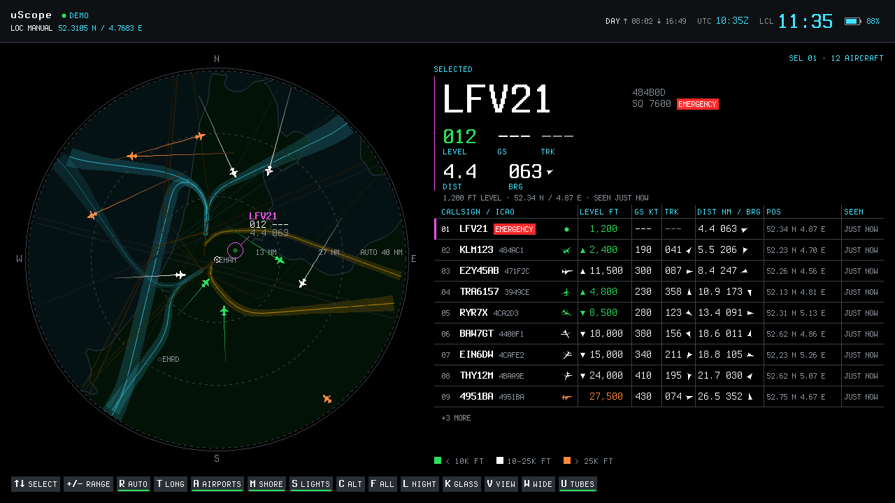
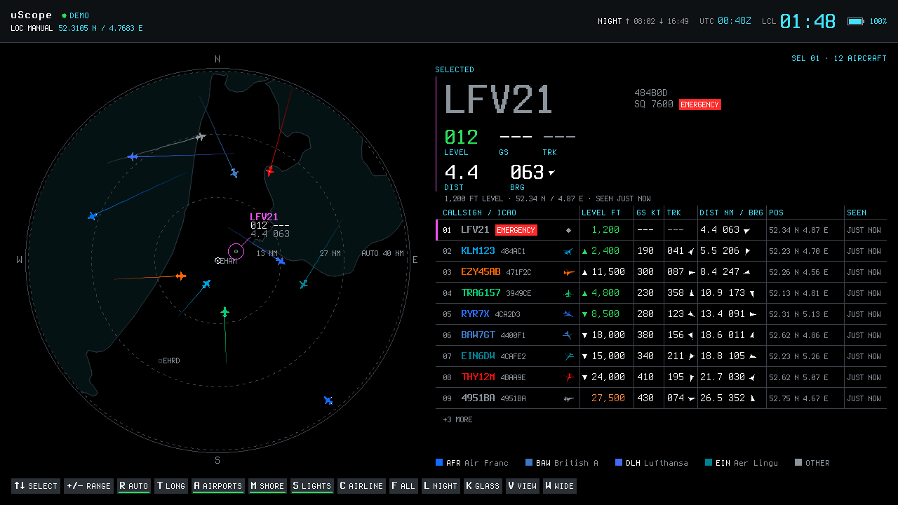
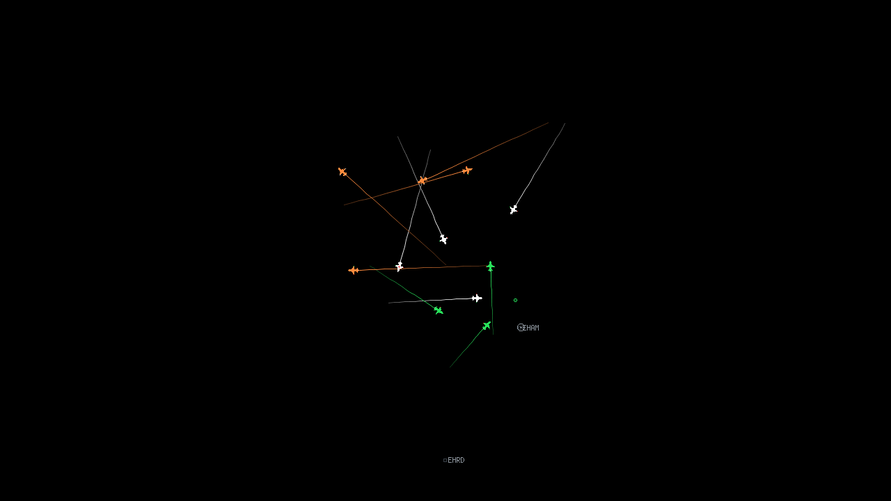
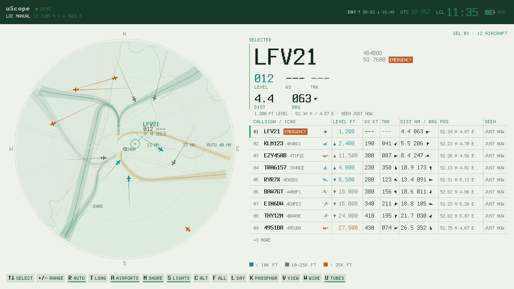
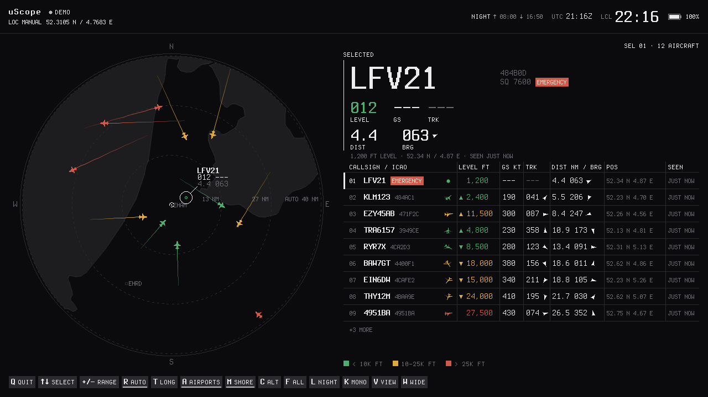

# uScope

An ADS-B radar scope for the ClockworkPi uConsole, drawn pixel by pixel on
the panel. One static binary, started from the shell, keyboard driven, `q` to
get back to the prompt.



Aircraft come in over the uConsole's own RTL-SDR, from a Mode S BEAST feed on
another machine, from a captured IQ file, or from an invented fleet so you can
try it at a desk with no receiver at all. Each one is drawn as a silhouette
turned to its heading with the trail it flew in on, coloured by altitude or by
the airline it is flying for, and carries its lights the way a real aircraft
does: red on the left wingtip, green on the right, white on the tail, white
strobes, and a red beacon flashing on the fuselage 46 times a minute. The
strobes double-flash twenty times a minute, half the slowest rate a real
aircraft may use and below the certified range on purpose: on a screen the
real cadence pulls the eye away from the traffic. `s` or `--lights off` turns
them off. Around them: the coastline, the water, the airfields, range rings,
a panel for the selected flight and a table of the rest.

uScope is the sister of [uAirwaves](https://github.com/hyperized/uAirwaves),
which does the same job in character cells with tview. uAirwaves is also where
the decoding comes from: uScope imports its ADS-B, GPS, battery and
self-locate packages and adds nothing but the picture.

It runs on a Mac too. Ghostty and other terminals that speak the Kitty
graphics protocol show the same frames in a window, and any terminal with
24-bit colour gets a half-block version. That is how the screenshots on this
page were made.

## What you see

### The scope

The picture above. Range rings measured from the receiver, cardinal letters,
the nearest airfields by ICAO code, and the Dutch coast at whatever range is
on. The range fits itself to the traffic unless you pin it with `+` and `-`.

The right column is the selected flight on top, the rows below it and the
legend at the bottom. Until you pick one, the selection follows the nearest
aircraft. `n`, `p` and the arrow keys pin it, and Esc lets go again. A squawk
of 7500, 7600 or 7700 puts `EMERGENCY` on the panel and on the row in red,
which is the one red thing on the whole screen.

The band across the top has the source and the receiver's position on the
left, and the UTC and local clocks on the right. Once the position is known,
the sun's state sits left of the clocks: `DAY`, `CIVIL TWILIGHT`,
`NAUTICAL TWILIGHT`, `ASTRONOMICAL TWILIGHT` or `NIGHT`, then today's sunrise
and sunset in local time, as in `DAY ↑ 08:09 ↓ 18:42`. The times
use the almanac's definition, the upper limb on the horizon, so they agree
with published tables to the minute. When the band is too narrow to fit it
beside the source label, the block is left out.

Colour means altitude by default: green under 10,000 ft, white to 25,000,
orange above. `c` switches to colouring by airline, read off the callsign
prefix, and the legend lists the four busiest operators in view. `f` filters
the picture down to one entry of whichever legend is showing. The altitude
stops have 500 ft of slack at each edge: an aircraft on screen stays there
until it is 500 ft past the line, and one off screen waits until it is 500 ft
inside, so a flight holding FL250 under the `>25K` stop does not flicker.

A new aircraft fades up from the background over two seconds. The first
frame, and the first frame after `f`, draw everything at full strength. When
the receiver stops hearing an aircraft, it stays where it was last heard,
pointing the way it was going with its trail behind it, and fades out over a
minute. This happens in every trail mode, and the filter treats it the way it
did while it was heard. A coasting aircraft carries no lights and cannot be
selected. The rows, the strips and the aircraft count leave it out, because
they list what is being heard. If it is heard again, its trail carries on
from the old one instead of growing back from a dot.



### The 3D view

`v` tilts the scope into perspective. Altitude becomes height, each aircraft
becomes a small model banked into its turn, and the camera orbits the receiver
once every two minutes. `e` draws the receiving envelope: the theoretical
radio horizon as a dashed bowl, and the measured one as a mesh built from
where the antenna has actually heard something, which is what shows a
directional antenna or a chimney in the way. The sea, the land and the
coastline carry on past the outer ring and fade towards the horizon instead of
ending at an edge.

Once the receiver's position is known, the sky above the horizon follows the
sun there: black at night, a band of deep blue in nautical twilight, an orange
horizon under a dark zenith around sunrise and sunset, gold with the sun low,
and pale blue by day. With the coastline on, the ground fades into the same
horizon colour, so at shallow tilts there is no line where the map stops and
the sky starts. Dawn and dusk look the same. Phosphor paints the sky
green, mono paints it grey, and the night palettes keep it dark. At the
default tilt the horizon is above the top of the picture; `[` or `--tilt 10`
brings the camera down until the sky comes into view. `--orbit off` and
`--azimuth` hold the camera still at a bearing of your choosing.

At night the sky carries a fixed field of stars, so you can see the slow orbit
turning even when there is no traffic to watch. They turn with the ground at
the ground's own rate. They are fully on once the sun is six degrees down and
fade out by sunrise, and they keep to the same brightness ceiling and the same
hue as the sky behind them. `z` or `--stars off` turns them off.


### Minimal

The third view is the aircraft and their trails on a bare field, with no
header, no column and no rings. With a directional antenna every contact
lands on one side, so minimal follows the traffic's own centre rather than the
receiver, gliding to a new centre every few minutes, and marks where the
antenna actually is with a small ring. The airfield markers are drawn there
too; `a` or `--minimal-airports off` takes them away, and `m` or
`--minimal-shore on` brings the coast back. There is a bare 3D view as well, fourth on the `v`
cycle. `h` or `--minimal-bar on` puts a thin bar across the top of both bare
views, with the wordmark and the feed's dot, the sun's state and times, and
the two clocks. The picture moves down to make room for it rather than being
covered.

Neither bare view has a key bar of its own. Press any key and one comes up
along the bottom for four seconds, drawn over the picture so nothing moves,
showing only the keys that work there.



### Corridors

Every aircraft that drops out of range leaves its track behind, and uScope
keeps it for a while. Tracks that flew the same way are bundled into a route,
and each arrival and departure route is drawn as a tube: the bundle's average
path down the middle, and its spread as the width. Arrivals come in from
several directions and all end on the same runway, so an arrival route is a
cone that narrows onto it. A departure route opens out the other way. A route
grows stronger as more tracks join it, and every track fades by half every two
hours, or whatever `--corridor-half-life` says, so a runway change shows as one
set of tubes fading out while the next one builds up.

Each track is sorted once, when it is lost, by where it began and ended
relative to one airfield: the nearest within 150 nm of the receiver, or the
one you name with `--corridor-field`. In the glass look a route of tracks that
ended within 10 nm of the field is cyan, an arrival. One whose tracks began
there and ended somewhere else is amber, a departure. Everything else is grey,
traffic passing through, and gets no tube: through traffic cruises at 17,000
to 25,000 ft, and in the 3D views its bundle floated thirty miles above its
own ground track as a wide grey sheet. The flat views still draw its tracks as
thin lines.

The flat views draw each tube as a translucent band on the ground. The 3D
views draw it in the air at the route's average altitude, as tall as the
bundle's spread in altitude, so arrivals slope down to the runway and
departures climb away from it. The tube is shaded like glass, dense along its
outline and thin where it faces you, with its back wall showing through and a
hairline down each side where it turns away. It has one ring, round its mouth
at the field. At the other end it fades out over its last four stations, and
it does the same wherever the filter or the edge of the view cuts it, so a
tube never seems to stop dead in mid-air. On the flat views a track that
shares its route with nobody is drawn on its own as a thin line. The 3D views
draw the tubes and no lines: lost tracks at eight times their real height were
a tangle that hid the tubes.

A tube only runs as far as its tracks agree. It starts at the runway and goes
outwards until fewer than three tracks have flown a stretch or until they are
spread more than 4 nm apart. Arrivals that share a final often come from entry
points tens of miles apart, and one tube drawn round all of them out there
comes out wide and twisted, which is not a path anybody flies. On the flat
views each track carries on past the end of its tube as a thin line, so the
fan-out stays on screen.

The `f` filter cuts a tube where its average altitude leaves the band on show.
A stretch whose altitude was never decoded is not drawn under any filter. In
airline colouring every route stays, since a filter on one airline's live
traffic says nothing about the corridors.

Nothing appears until there is an airfield, which takes a receiver position (a
GPS fix, `--lat` and `--lon`, or a self-locate estimate that has settled to
within 10 nm) or `--corridor-field`, and until the first aircraft is lost.
`--demo` starts with seventy invented tracks around Schiphol from the last two
hours, so there is something to look at. `u` or `--corridors off` hides the
corridors in every view. The `U TUBES` cap is on the flat views' key bar and
the bare views' reveal. The 3D view's bar has no room for it, but the key
works there too. The lost tracks live in memory, so a restart starts the
corridors from nothing.

### Looks and themes

There are three looks, each with a night and a day palette. Glass is the
default, phosphor is a green CRT, and mono is black and white with the
altitude bands told apart by brightness. `k` cycles the look and `l` steps
through night, day and auto.

Auto is the default. It picks day while the sun at the receiver is above the
horizon, and night otherwise, so the sky's dusk colours play on the dark
palette. It checks every ten seconds, and at once when the receiver moves.
With no position for the receiver yet it stays on night. The `L` cap reads
`AUTO·DAY` or `AUTO·NIGHT` so you can see what it picked.

| | |
|---|---|
|  |  |

## Getting it running

You need Go 1.27 or later to build. There is nothing to install at runtime:
the fonts, the coastlines and the airline table are inside the binary.

### On the uConsole

Put your device in a `.env` next to the Makefile. It is gitignored:

```
DEVICE = user@uconsole-host
```

Then:

```sh
make pattern
```

That cross-compiles for arm64, copies the binary over ssh, and paints a test
pattern on the panel. A red square top left and a cyan triangle pointing up
means the rotation is right. If the pattern lands on the wrong edge, the
panel disagrees with what `/sys/class/graphics/fbcon/rotate` says, and
`--rotate 3` is the override.

From then on, at the uConsole's own shell:

```sh
./uScope
```

opens the local RTL-SDR and draws the radar on the panel. `./uScope --demo`
flies the invented fleet instead. It needs no root, only a user in the `video`
group so it can write `/dev/fb0`, which is the case on a stock uConsole image.

If gpsd is running on the device, uScope finds it on `localhost:2947` and the
header goes green when there is a fix. Without it, the receiver's position is
worked out from the aircraft, which takes a minute or two of traffic.

### On a Mac or any other machine

```sh
make run-demo
```

is `go run . --demo`. In Ghostty, kitty or WezTerm the frame is drawn at its
real pixel size. In any other terminal it falls back to half blocks, one
pixel per half cell, which is coarse but works everywhere:

```sh
make run-blocks
```

There is no radio on a Mac, so `--demo` or `--beast host:30005` are the ways
to get traffic. Both leave the shell as they found it.

### Over ssh

From a Kitty-protocol terminal on your desk, into the uConsole:

```sh
ssh -t user@uconsole-host './uScope --backend kitty'
```

The frames travel back over the connection and appear in your window while
the uConsole's own screen stays untouched. The `-t` matters: without a
terminal on the far end there is no window size and no keyboard, so no `q`.
`--backend blocks` is the one to reach for on a slow link.

### A still frame

```sh
./uScope --demo --png radar.png
./uScope --demo --view 3d --png radar-3d.png --size 1920x1080
```

renders one frame to a file, which is how every image on this page was made.

The layout follows the canvas height. Up to 2159 pixels tall every size is
the one the panel uses; at 2160 (4K) the type, the key bar, the column, the
markers and the line widths are all drawn at twice that, at 4320 four times,
so a large `--size` gives the same picture rather than a small one in a big
frame.

## Where the aircraft come from

| Flag | Source |
|---|---|
| none | the local RTL-SDR, opened through uAirwaves' own driver |
| `--beast HOST:PORT` | a Mode S BEAST feed over TCP, from readsb, dump1090 or `demod1090 --beast-listen` |
| `--replay-iq PATH` | a captured IQ file played back through the same demodulator |
| `--demo` | twelve invented aircraft on straight tracks, one of which goes quiet after ninety seconds |

`--bias-t` powers an LNA up the coax from the dongle, and `b` toggles it
while running. `--auto-sweep` walks the dongle's gain grid once before the
first frame and keeps the best cell. Both apply to the local SDR only; on a
BEAST feed the gain belongs to the other end.

## Where the receiver is

The header's second line says where the receiver is and how that is known,
and the ring around the home marker takes the same colour.

| Header | Ring | Means |
|---|---|---|
| `LOC GPS 3D 52.3100 N / 4.7683 E` | green | a gpsd fix |
| `LOC GPS LOST …` | amber | the fix went; the last position is held for thirty seconds |
| `LOC MANUAL …` | ink | `--lat` and `--lon` |
| `LOC EST ±4 NM / MAX 97 NM` | amber, dashed | worked out from the aircraft |
| `LOC NO FIX` | grey | nothing known yet, nothing plotted |

The estimate needs no GPS and no internet. Every aircraft heard constrains
the receiver to that aircraft's radio horizon, and the intersection of enough
of those is where you are. Two figures come with it: the spread, which is how
far the answer moves when it is worked out from a fifth of the observations,
and the bound, which is the size of the region the horizons admit. The dashed
ring is drawn at the spread. A `?` after them means the horizons cannot all be
true at once and the answer is a compromise.

## Keys

| Key | Does |
|---|---|
| `q` | quit; it has no cap on the key bar, but it still works |
| `v` | cycle the view: scope, 3D, minimal, bare 3D |
| `n`, Down | select the next aircraft |
| `p`, Up | select the previous one |
| `Esc` | let the selection follow the nearest aircraft again |
| `+`, `-` | widen or narrow the range by one step, and turn auto range off |
| `r` | auto range on or off |
| `t` | cycle the trails: off, short, long, all. All keeps the trails of aircraft that have gone quiet |
| `a` | airfield markers on or off |
| `m` | coastline and water on or off |
| `s` | the aircraft lights on or off, in every view |
| `u` | the corridor tubes on or off, in every view |
| `h` | bare views: the bar across the top on or off |
| `c` | colour by altitude or by airline |
| `f` | filter to one entry of the legend, then back to all |
| `l` | night, day or auto by the sun |
| `k` | glass, phosphor or mono |
| `w` | hide the right column and give the picture the whole width |
| `b` | bias-tee on or off, when the source has one |
| `e` | 3D view: the receiving envelope on or off |
| `o` | 3D views: the camera orbit on or off |
| Left, Right | 3D views: turn the camera 15 degrees and stop the orbit |
| `[`, `]` | 3D views: tilt the camera |
| `z` | 3D views: the stars in the night sky on or off |

Shifted letters do the same as unshifted, because caps lock is easy to hit on
the uConsole's keyboard. The key bar along the bottom shows every key that
does something in the view on screen, with its current state. The full 3D
view's bar has no room for `z` or `u`; the bare 3D view's has. The bare views hide
the bar until a key is pressed, then show it for four seconds; another press
starts the four seconds again.

## Flags

| Flag | Default | Does |
|---|---|---|
| `--demo` | off | fly the invented fleet instead of decoding |
| `--demo-sector` | off | put the invented fleet in one quadrant, as a directional antenna would |
| `--beast` | | take Mode S frames from `HOST:PORT` |
| `--replay-iq` | | replay a captured IQ file |
| `--bias-t` | off | power an LNA over the coax; local SDR only |
| `--auto-sweep` | off | find the best gain before the first frame; local SDR only |
| `--gpsd` | `localhost:2947` on Linux, `off` elsewhere | where gpsd is, or `off` |
| `--lat`, `--lon` | | the receiver's position in degrees; turns gpsd and the estimate off |
| `--view` | `scope` | `scope`, `3d`, `minimal` or `minimal3d` |
| `--range` | `auto` | range in nautical miles, or `auto` to fit the traffic |
| `--colour` | `altitude` | `altitude` or `airline` |
| `--theme` | `auto` | `night`, `day`, or `auto` to follow the sun at the receiver |
| `--look` | `glass` | `glass`, `phosphor` or `mono` |
| `--airports` | `on` | airfield markers |
| `--shore` | `on` | coastline and water |
| `--minimal-shore` | `off` | coastline and water in `minimal` and `minimal3d`; `m` still flips it |
| `--minimal-airports` | `on` | airfield markers in `minimal` and `minimal3d`; `a` still flips it |
| `--minimal-bar` | `off` | the bar with the clocks and the sun across the top of `minimal` and `minimal3d`; `h` still flips it |
| `--lights` | `on` | the aircraft lights: red and green wingtips, white tail, strobes and the beacon; `s` still flips them |
| `--stars` | `on` | stars in the 3D views' night sky; `z` flips them |
| `--corridors` | `on` | draw the routes lost aircraft flew as tubes, fading with age, see "Corridors"; `u` flips them |
| `--corridor-field` | | the airfield tracks are sorted into arrivals and departures by, as an ICAO code; empty takes the nearest within 150 nm of the receiver |
| `--corridor-half-life` | `2h` | how long a lost track takes to count for half as much in its route, `10m` to `24h` |
| `--exaggerate` | `8` | how far the 3D view stretches altitude into height, 1 to 20 |
| `--zoom` | `0` | range steps inside the `auto` fit, `-5` to `5`; negative widens, the view keeps following the traffic, `+` and `-` still turn auto off, and a fixed `--range` ignores it |
| `--tilt` | `35` | the 3D camera's starting elevation in degrees, 10 to 80; `[` and `]` step from it |
| `--orbit` | `on` | whether the 3D camera turns on its own; `o` flips it |
| `--azimuth` | `0` | where the 3D camera stands, degrees clockwise from north, 0 up to 360; where the orbit starts, or where the camera stays with `--orbit off` |
| `--recenter` | `3m` | how often minimal mode recentres on the traffic, `10s` to `1h`, or `0` |
| `--backend` | `auto` | `fb`, `kitty`, `blocks` or `png`; `auto` picks the first that works |
| `--fb` | `/dev/fb0` | framebuffer device |
| `--rotate` | `auto` | read fbcon's rotation, or force `0` to `3` |
| `--battery` | | a `power_supply` uevent file to read the battery from, or `off` for no indicator; Linux only, found on its own otherwise |
| `--fps` | `30` | frames per second |
| `--frames` | `0` | stop after this many frames |
| `--png` | | render one frame to this file and exit |
| `--size` | `1280x720` | canvas size for `--png` and the kitty backend; the layout scales with the height in whole steps of 1080 |

| `--test-pattern` | off | draw one frame of the test pattern and exit |
| `--scene` | `radar` | `radar`, or `pattern` for the rotation check |

Exit status is 0 on a clean quit and 1 on any failure.

## Building and testing

```sh
make build          # for the machine you are on
make build-aarch64  # for the uConsole
make test           # go test -race -cover ./...
make lint           # golangci-lint run ./...
make ship           # copy the uConsole binary to $(DEVICE)
make test-device    # run the framebuffer and terminal tests on the device
```

Everything is standard library apart from the `github.com/hyperized/*`
modules, and none of it needs cgo, so `make build-aarch64` cross-compiles
from any machine with Go on it. `make test` never opens a device; the tests
that need a real framebuffer or a real tty run on the uConsole through
`make test-device`.

`make shore-data` rebuilds the embedded coastlines from Natural Earth. It is
the one target that needs the network, and it only needs running when Natural
Earth publishes a new release.

## Licence

Business Source License 1.1, free for non-commercial use, becoming Apache 2.0
ten years after release. See [LICENSE](LICENSE).
