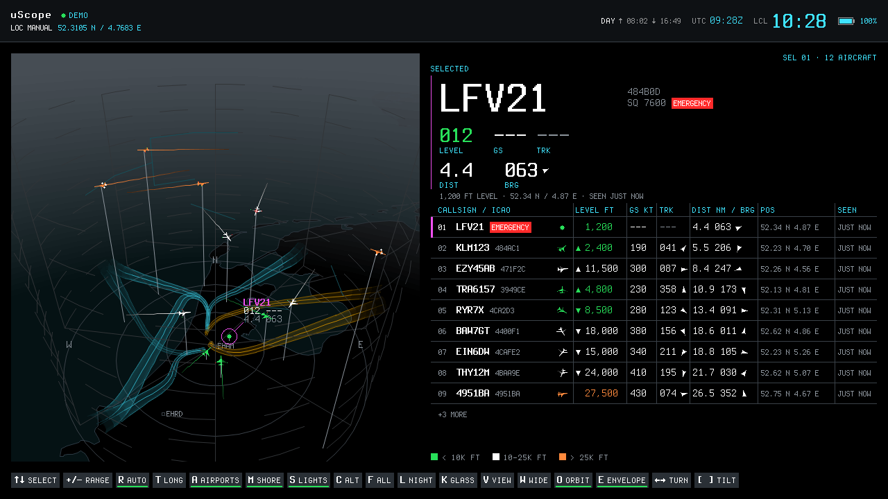
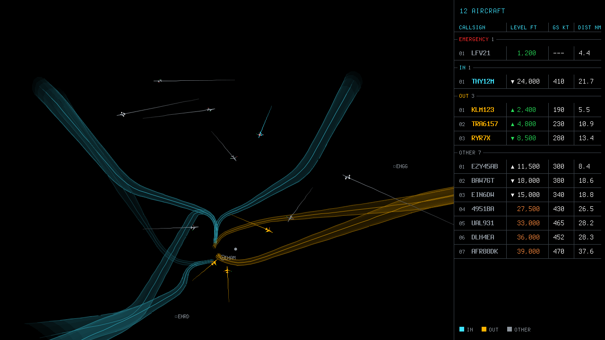
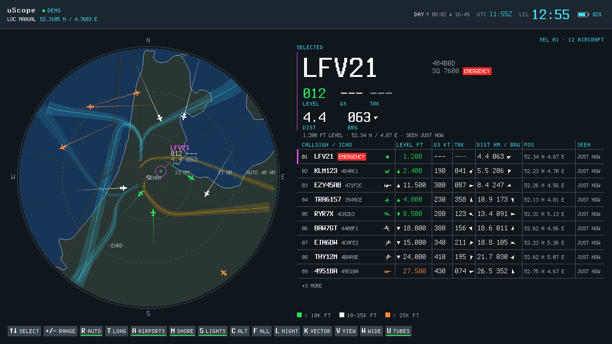

# uScope

An ADS-B radar scope for the ClockworkPi uConsole, drawn pixel by pixel on
the panel. One static binary, started from the shell, keyboard driven, `q` to
get back to the prompt. It runs in a terminal on any other machine too, which
is how the pictures on this page were made.


To see it without a receiver, with Go 1.27 or later:

```sh
git clone https://github.com/hyperized/uScope.git
cd uScope
go run . --demo
```

That flies twelve invented aircraft around Schiphol. Press `v` to cycle the
views, `c` to change what the colours mean, and `q` to quit.

uScope is the sister of [uAirwaves](https://github.com/hyperized/uAirwaves),
which does the same job in character cells with tview. uAirwaves is also where
the decoding comes from: uScope imports its ADS-B, GPS, battery and
self-locate packages and adds nothing but the picture.

## Getting it running

There is nothing to install at runtime: the fonts, the coastlines and the
airline table are inside the binary.

### On a Mac or any other machine

```sh
make run-demo
```

is `go run . --demo`. In Ghostty, kitty or WezTerm the frame is drawn at its
real pixel size. Any other terminal with 24-bit colour gets half blocks, one
pixel per half cell, which is coarse but works everywhere:

```sh
make run-blocks
```

There is no radio driver outside Linux, so a run with no source flag flies
the demo fleet and says so on stderr. `--beast host:30005` takes real traffic
from a receiver elsewhere. Either way the shell is left as it was found.

### On the uConsole

Put your device in a `.env` next to the Makefile. It is gitignored:

```
DEVICE = user@uconsole-host
```

Then:

```sh
make pattern
```

That cross-compiles for arm64, copies the binary over ssh, and paints a test
pattern on the panel. A red square top left and a cyan triangle pointing up
means the rotation is right. If the pattern lands on the wrong edge, the
panel disagrees with what `/sys/class/graphics/fbcon/rotate` says, and
`--rotate 3` is the override.

From then on, at the uConsole's own shell:

```sh
./uScope
```

opens the local RTL-SDR and draws the radar on the panel. It needs no root,
only a user in the `video` group so it can write `/dev/fb0`, which is the case
on a stock uConsole image.

If gpsd is running on the device, uScope finds it on `localhost:2947` and the
header goes green when there is a fix. Without it, the receiver's position is
worked out from the aircraft, which takes a minute or two of traffic.

### Over ssh

From a Kitty-protocol terminal on your desk, into the uConsole:

```sh
ssh -t user@uconsole-host './uScope --backend kitty'
```

The frames travel back over the connection and appear in your window while
the uConsole's own screen stays untouched. The `-t` matters: without a
terminal on the far end there is no window size and no keyboard, so no `q`.
`--backend blocks` is the one to reach for on a slow link.

### A still frame

```sh
./uScope --demo --png radar.png
./uScope --demo --view 3d --png radar-3d.png --size 1920x1080
```

renders one frame to a file and exits. The layout grows with the canvas
height in whole steps: up to 2159 pixels tall everything is drawn at the size
the panel uses, from 2160 (4K) at twice that, from 3240 at three times, and so
on. A large `--size` gives the same picture rather than a small one in a big
frame.

## What you see

### The scope

Range rings measured from the receiver, cardinal letters, the nearest
airfields by ICAO code, and the coastline over a faintly tinted sea and land.
The range fits itself to the traffic unless you pin it with `+` and `-`.

Each aircraft is a silhouette turned to its heading with the trail it flew in
on, and carries its lights: red on the left wingtip, green on the right, white
on the tail, white strobes, and a red beacon on the fuselage flashing 46 times
a minute. The strobes double-flash twenty times a minute, slower than a real
aircraft's, because on a screen the real cadence pulls the eye away from the
traffic. `s` turns the lights off.

The right column is the selected flight on top, the rows below it and the
legend at the bottom. Until you pick one, the selection follows the nearest
aircraft. `n`, `p` and the arrow keys pin it, and Esc lets go again. A squawk
of 7500, 7600 or 7700 puts `EMERGENCY` on the panel and on the row in red.

The band across the top has the source and the receiver's position on the
left, and the UTC and local clocks on the right. Once the position is known,
the sun's state sits left of the clocks (`DAY`, `CIVIL TWILIGHT`,
`NAUTICAL TWILIGHT`, `ASTRONOMICAL TWILIGHT` or `NIGHT`) with today's sunrise
and sunset in local time, as in `DAY ↑ 08:09 ↓ 18:42`. The times use the
almanac's definition, the upper limb on the horizon, so they agree with
published tables to the minute. When the band is too narrow, the block is
left out.

A new aircraft fades up over two seconds. When the receiver stops hearing
one, it stays where it was last heard, pointing the way it was going, and
fades out over a minute. A fading aircraft carries no lights, cannot be
selected and is left out of the rows and the count, which list what is being
heard. If it is heard again, its trail carries on from the old one instead of
growing back from a dot.

#### Colour and filter

Colour means altitude by default: green under 10,000 ft, white to 25,000,
orange above. `c` switches to colouring by airline, read off the callsign
prefix, with the four busiest operators in view in the legend.


Press `c` again to colour by corridor: an aircraft that looks to be arriving
at the corridor airfield (see [Corridors](#corridors)) is cyan, one leaving it
amber, and everything else grey. The legend reads `IN`, `OUT` and `OTHER`, and
the list splits into those three sections, each under a heading with its
count and each nearest first. A section with fewer aircraft than its third of
the lines hands the rest on; one that runs out of room ends on `+N MORE`. With
no airfield placed every aircraft is grey and sits under `OTHER`. In all
three colourings the level column and the panel's altitude keep the altitude
colours.

`f` narrows the picture to one entry of whichever legend is showing, then
back to all. By altitude and by corridor the cycle has one more stop, `<25K`,
which hides the overflights. An aircraft near a band's edge has 500 ft of
slack either way, so a flight holding FL250 under `<25K` does not flicker.
`--filter` starts the run on one of the stops; see the flags table for which
stop belongs to which colouring.

### The 3D view

`v` tilts the scope into perspective. Altitude becomes height, each aircraft
becomes a small model banked into its turn, and the camera orbits the receiver
once every two minutes. `e` draws the receiving envelope: the theoretical
radio horizon as a dashed bowl, and the measured one as a mesh built from
where the antenna has actually heard something, which is what shows a
directional antenna or a chimney in the way. The sea, the land and the
coastline carry on past the outer ring and fade towards the horizon.



Once the receiver's position is known, the sky follows the sun there: black
at night, deep blue in nautical twilight, an orange horizon under a dark
zenith around sunrise and sunset, gold with the sun low, and pale blue by day.
The ground fades into the same horizon colour, so there is no line where the
map stops. Phosphor paints the sky green, mono grey, and the night palettes
keep it dark. At the default tilt the horizon is above the top of the
picture; `[` or `--tilt 10` brings the camera down until the sky comes into
view. `--orbit off` and `--azimuth` hold the camera still at a bearing of your
choosing.

At night the sky carries a fixed field of stars that turn with the ground, so
the orbit shows even with no traffic. They are fully on once the sun is six
degrees down and gone by sunrise. `z` turns them off.

### The bare views

Minimal, third on the `v` cycle, is the aircraft and their trails on a bare
field: no header, no column, no rings. With a directional antenna every
contact lands on one side, so minimal follows the traffic's own centre rather
than the receiver, gliding to a new centre every few minutes (`--recenter`),
and marks where the antenna is with a small ring.


The bare 3D view, fourth, does the same in perspective. Both keep their own
airfield and coastline switches, separate from the full views': `a` and `m`
flip them, and they start with the airfields on and the coast off. `h` puts a
thin bar across the top with the wordmark, the feed's dot, the sun and the
clocks; the picture moves down to make room for it.

`j` gives the bare 3D view the flight strip board down its right quarter, for
a big screen nobody is standing at to ask who an aeroplane is. It has the
aircraft count at the top (`8 OF 12 AIRCRAFT` while `f` is holding some back),
a strip per aircraft nearest first, and a legend at the bottom. At 1280x720 a
strip carries the callsign, level, ground speed, distance and `DIR`: `IN`,
`OUT` or `---` by the same guess the corridor colouring makes. A bigger canvas
brings back more of the column's fields. Coloured by corridor, the board
splits into IN, OUT and OTHER the way the full views' list does.



Neither bare view has a key bar of its own. Press any key and one comes up
along the bottom for four seconds, drawn over the picture, with only the keys
that work there.

### Corridors

Every aircraft that drops out of range leaves its track behind, and uScope
keeps it for a while. Tracks that flew the same way are bundled into a route,
and each arrival and departure route is drawn as a tube: the bundle's average
path down the middle, its spread as the width. Arrivals from several
directions end on the same runway, so an arrival tube is a cone narrowing
onto it; a departure opens out the other way. Every track fades by half every
two hours (`--corridor-half-life`), so a runway change shows as one set of
tubes fading out while the next builds up.

Each track is sorted once, when it is lost, against one airfield: the
nearest within 150 nm of the receiver, or the one you name with
`--corridor-field`. A track that ended within 10 nm of the field is an
arrival, drawn cyan. One that began there and ended somewhere else is a
departure, drawn amber. Everything else is traffic passing through and gets
no tube; the flat views draw its tracks as thin grey lines.

The flat views draw a tube as a translucent band on the ground. The 3D views
draw it in the air at the route's average altitude, so arrivals slope down to
the runway and departures climb away, shaded like glass with a ring round its
mouth at the field. A tube only runs as far as its tracks agree: from the
runway outwards until fewer than three tracks share a stretch or they spread
more than 4 nm apart. Where it ends, or where the filter or the edge of the
view cuts it, it fades out rather than stopping dead. On the flat views each
track carries on past its tube as a thin line, so the fan-out stays on
screen.

The `f` altitude stops cut a tube where its average altitude leaves the bands
on show, so `<25K` cuts the top off every climb and leaves the finals. The
airline and corridor stops keep every route.

Nothing appears until there is an airfield and the first aircraft has been
lost. An airfield needs `--corridor-field` or a receiver position: a GPS fix,
`--lat` and `--lon`, or a self-locate estimate settled to within 10 nm.
`--demo` starts with seventy invented tracks from the last two hours, so there
is something to look at. `u` hides the corridors in every view.

The lost tracks live in memory, so a restart starts the corridors from
nothing unless `--history PATH` names a file to keep them in. uScope reads it
back before the first frame, writes it once a minute while the tracks change,
and once more when it stops. Aircraft still in the sky at that point are
saved as lost and come back to life when the feed hears them again. A track
older than six half-lives is dropped on the way in. The live traffic, its
trails and the self-locate estimate are not kept, and the demo fleet ignores
the flag, since it invents the same tracks every run.

The file is written as a new file renamed over the old one, so a kill part
way through leaves the previous one whole. A file that will not read costs one
line on stderr and an empty start; a failed write costs one line per distinct
cause and uScope carries on. A full file is about 16 MB, and anything over
48 MiB is refused unread. Put it somewhere that survives a reboot, such as
`~/.local/state/uscope/history`; the directory has to exist already.

### Looks and themes

There are four looks, each with a night and a day palette. Glass is the
default, phosphor is a green CRT, and mono is black and white with the
altitude bands told apart by brightness. Vector keeps glass's hues on a field
lifted off black, with a clear blue sea and a grey-green land strong enough to
stay apart under the route tubes. `k` cycles the look and `l` steps through
night, day and auto.



Auto, the default, picks day while the sun at the receiver is above the
horizon and night otherwise, so the sky's dusk colours play on the dark
palette. It checks every ten seconds and at once when the receiver moves, and
stays on night until the receiver has a position. The `L` cap reads
`AUTO·DAY` or `AUTO·NIGHT` so you can see what it picked.

| | |
|---|---|
|  |  |

## Where the aircraft come from

| Flag | Source |
|---|---|
| none | the local RTL-SDR on Linux, opened through uAirwaves' own driver; the demo fleet anywhere else |
| `--beast HOST:PORT` | a Mode S BEAST feed over TCP, from readsb, dump1090 or `demod1090 --beast-listen` |
| `--replay-iq PATH` | a captured IQ file played back through the same demodulator |
| `--demo` | twelve invented aircraft on straight tracks, one of which goes quiet after ninety seconds |

`--bias-t` powers an LNA up the coax from the dongle, and `b` toggles it
while running. `--auto-sweep` walks the dongle's gain grid once before the
first frame and keeps the best cell. Both apply to the local SDR only; on a
BEAST feed the gain belongs to the other end.

## Where the receiver is

The header's second line says where the receiver is and how that is known,
and the ring around the home marker takes the same colour.

| Header | Ring | Means |
|---|---|---|
| `LOC GPS 3D 52.3100 N / 4.7683 E` | green | a gpsd fix |
| `LOC GPS LOST …` | amber | the fix went; the last position is held for thirty seconds |
| `LOC MANUAL …` | ink | `--lat` and `--lon`, or the demo's fixed position |
| `LOC EST ±4 NM / MAX 97 NM` | amber, dashed | worked out from the aircraft |
| `LOC NO FIX` | grey | nothing known yet, nothing plotted |

The estimate needs no GPS and no internet. Every aircraft heard constrains
the receiver to that aircraft's radio horizon, and the intersection of enough
of those is where you are. Two figures come with it: the spread, which is how
far the answer moves when it is worked out from a fifth of the observations,
and the bound, which is the size of the region the horizons admit. The dashed
ring is drawn at the spread. A `?` after them means the horizons cannot all be
true at once and the answer is a compromise.

## Keys

| Key | Does |
|---|---|
| `q`, Ctrl-C | quit |
| `v` | cycle the view: scope, 3D, minimal, bare 3D |
| `n`, Down | select the next aircraft |
| `p`, Up | select the previous one |
| Esc | let the selection follow the nearest aircraft again |
| `+`, `-` | widen or narrow the range by one step, and turn auto range off; `=` and `_` work too |
| `r` | auto range on or off |
| `t` | cycle the trails: off, short, long, all. All keeps the trails of aircraft that have gone quiet |
| `a` | airfield markers on or off; the bare views keep their own switch |
| `m` | coastline, sea and land on or off; the bare views keep their own switch |
| `s` | the aircraft lights on or off |
| `u` | the corridor tubes on or off |
| `c` | colour by altitude, by airline or by corridor; puts the filter back to all |
| `f` | filter to one legend entry, then back to all. By altitude the stops are `<10K`, `10-25K`, `>25K` and `<25K`, by corridor `IN`, `OUT`, `OTHER` and `<25K`, by airline each operator in the legend |
| `l` | night, day or auto by the sun |
| `k` | glass, phosphor, mono or vector |
| `b` | bias-tee on or off, when the source has one |
| `w` | scope and 3D: hide the right column and give the picture the whole width |
| `e` | 3D: the receiving envelope on or off |
| `o` | 3D and bare 3D: the camera orbit on or off |
| Left, Right | 3D and bare 3D: turn the camera 15 degrees and stop the orbit |
| `[`, `]` | 3D and bare 3D: tilt the camera by 5 degrees, between 10 and 80 |
| `z` | 3D and bare 3D: the stars in the night sky on or off |
| `h` | bare views: the bar across the top on or off |
| `j` | bare 3D: the strip board on or off |

Shifted letters do the same as unshifted, because caps lock is easy to hit on
the uConsole's keyboard. A key that does nothing in the view on screen is
ignored rather than remembered for later.

The key bar along the bottom shows the keys for the view on screen with their
current state. `q` has no cap. The full 3D view's bar has no room for `z` or
`u`, though both keys work there. The bare views show their bar for four
seconds after any key press, and the bare 3D one shares a single `CAMERA` cap
between the arrows and the brackets.

## Flags

| Flag | Default | Does |
|---|---|---|
| `--demo` | off | fly the invented fleet instead of decoding |
| `--demo-sector` | off | put the invented fleet in the north-west quadrant, as a directional antenna would |
| `--beast` | | take Mode S frames from `HOST:PORT` |
| `--replay-iq` | | replay a captured IQ file |
| `--bias-t` | off | power an LNA over the coax; local SDR only |
| `--auto-sweep` | off | find the best gain before the first frame; local SDR only |
| `--gpsd` | `localhost:2947` on Linux, `off` elsewhere | where gpsd is, or `off` |
| `--lat`, `--lon` | | the receiver's position in degrees, -90 to 90 and -180 to 180, always as a pair; turns gpsd and the estimate off |
| `--view` | `scope` | `scope`, `3d`, `minimal` or `minimal3d` |
| `--range` | `auto` | range in nautical miles, 20 to 500, or `auto` to fit the traffic |
| `--zoom` | `0` | range steps inside the `auto` fit, `-5` to `5`; negative widens. Ignored with a fixed `--range` |
| `--colour` | `altitude` | `altitude`, `airline` or `corridor` |
| `--filter` | `all` | the `f` stop to start on: `low`, `mid` or `high` with altitude colouring, `in`, `out` or `other` with corridor colouring, `below-high` (under 25,000 ft) with either. A stop the colouring does not have starts on `all` |
| `--theme` | `auto` | `night`, `day`, or `auto` to follow the sun at the receiver |
| `--look` | `glass` | `glass`, `phosphor`, `mono` or `vector` |
| `--airports` | `on` | airfield markers in the scope and 3D views |
| `--shore` | `on` | coastline, sea and land in the scope and 3D views |
| `--minimal-airports` | `on` | airfield markers in `minimal` and `minimal3d` |
| `--minimal-shore` | `off` | coastline, sea and land in `minimal` and `minimal3d` |
| `--minimal-bar` | `off` | the bar with the clocks and the sun across the top of `minimal` and `minimal3d` |
| `--minimal-board` | `off` | the flight strip board down the right quarter of `minimal3d` |
| `--lights` | `on` | the aircraft lights |
| `--stars` | `on` | stars in the 3D views' night sky |
| `--corridors` | `on` | the corridor tubes |
| `--corridor-field` | | the airfield tracks are sorted by, as an ICAO code; empty takes the nearest within 150 nm |
| `--corridor-half-life` | `2h` | how long a lost track takes to count for half as much, `10m` to `24h` |
| `--history` | `off` | keep the lost tracks in this file across a restart; live sources only |
| `--exaggerate` | `8` | how far the 3D view stretches altitude into height, 1 to 20 |
| `--tilt` | `35` | the 3D camera's starting elevation in degrees, 10 to 80 |
| `--orbit` | `on` | whether the 3D camera turns on its own |
| `--azimuth` | `0` | where the 3D camera stands, degrees clockwise from north, 0 up to 360; where the orbit starts, or where the camera stays with `--orbit off` |
| `--recenter` | `3m` | how often minimal mode recentres on the traffic, `10s` to `1h`, or `0` to stay on the receiver |
| `--backend` | `auto` | `fb`, `kitty`, `blocks` or `png`; `auto` picks the first that works |
| `--fb` | `/dev/fb0` | framebuffer device |
| `--rotate` | `auto` | read fbcon's rotation, or force `0` to `3` |
| `--battery` | | a `power_supply` uevent file to read the battery from, or `off` for no indicator; empty finds one, Linux only |
| `--fps` | `30` | frames per second, 1 to 120 |
| `--frames` | `0` | stop after this many frames, up to 1000; `0` runs until you quit |
| `--png` | | render one frame to this file and exit |
| `--size` | `1280x720` | canvas size for `--png` and the kitty backend, each side up to 8192 |
| `--test-pattern` | off | draw one still frame of the chosen scene and exit, leaving the console untouched |
| `--scene` | `radar` | `radar`, or `pattern` for the rotation check |

Every flag that takes `on` or `off` has a key that flips it while running;
see the keys table.
Exit status is 0 on a clean quit and 1 on any failure.

## Building and testing

```sh
make build          # for the machine you are on
make build-aarch64  # for the uConsole
make test           # go test -race -cover ./...
make lint           # golangci-lint run ./...
make ship           # copy the uConsole binary to $(DEVICE)
make test-device    # run the framebuffer and terminal tests on the device
```

uScope imports the standard library and the `github.com/hyperized/*` modules
and nothing else, and none of it needs cgo, so `make build-aarch64`
cross-compiles from any machine with Go on it. `make test` never opens a
device; the tests that need a real framebuffer or a real tty run on the
uConsole through `make test-device`.

`make shore-data` rebuilds the embedded coastlines from Natural Earth. It is
the one target that needs the network, and it only needs running when Natural
Earth publishes a new release.

## Licence

Business Source License 1.1 with a grant for non-commercial use. See
[LICENSE](LICENSE) for when it becomes Apache 2.0.
